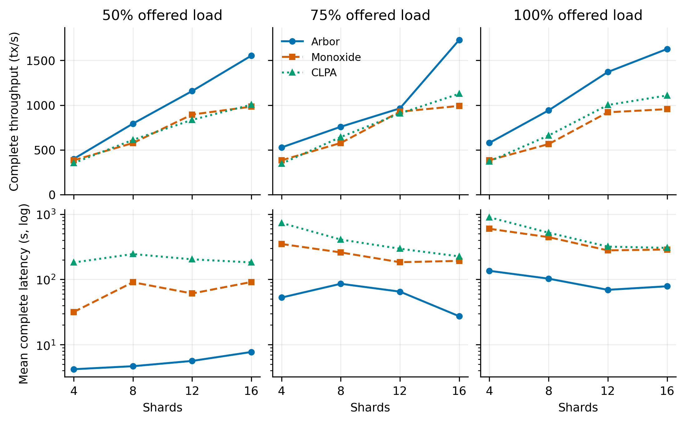
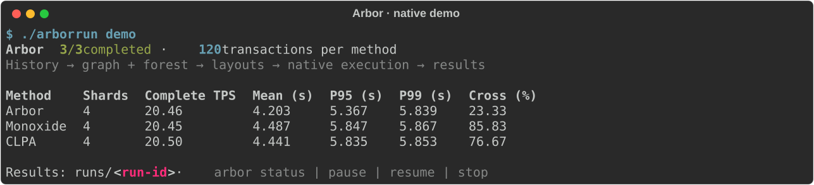

# Arbor

**Temporal and source-aware account placement for sharded blockchains.**

Arbor combines a temporal account graph, an entry forest and incremental admission to keep interacting accounts together while distributing their associated demand. It includes Arbor, Monoxide and dynamic CLPA, a native PBFT execution engine, frozen models and one CLI for the complete experiment workflow.

[中文](README.zh-CN.md) · [Experiments](docs/experiments.md) · [Data and models](docs/data-models.md) · [Architecture](docs/architecture.md) · [Run management](docs/running.md)

Across **12 matched shard/load configurations**, Arbor reduces mean complete latency by **64.61%–94.83% against Monoxide** and **74.21%–98.09% against CLPA**, with higher complete throughput in every configuration.



*Paper reference measurements: 4/8/12/16 shards, 50%/75%/100% offered load; one measurement per cell. Latency uses a log axis. [Data](reference/scale_load.csv) · [Plot script](scripts/render_readme.py).*

## Run the example

Linux or WSL2; Ubuntu 24.04, Python 3.12 and a C++17 compiler. The installer uses Go 1.22+ or downloads Go 1.22.0 locally when needed.

```bash
sudo apt-get update
sudo apt-get install -y python3.12 python3.12-venv g++ git
git clone https://github.com/JiaoTang666/arbor.git
cd arbor
./install.sh
./arbor run demo
```

The example prepares synthetic history, builds the graph, forest and layouts, then completes **120 transactions per method** on local native nodes. Allow about one minute after installation; output timing depends on the host.



The display shows the active case, progress and final performance table. Ctrl+C detaches the display while the queue continues in the background.

## Prepare data and run experiments

Download [XBlock Block Transaction](https://xblock.pro/xblock-eth.html) data from its official source. The paper uses the period covered by [`18750000to18999999_BlockTransaction.zip`](https://zhengpeilin.com/download.php?file=18750000to18999999_BlockTransaction.zip). Save the archive under `data/raw/`, then prepare a local window:

```bash
./arbor data paper
./arbor data xblock \
  --source data/raw/18750000to18999999_BlockTransaction.zip \
  --history-count 8840117 --test-count 979572 --output data/paper
./arbor run scale --cleanup-db
./arbor results runs/<run-id> --plot
```

| Command | Experiment |
|---|---|
| `./arbor run full` | One Arbor run: 16 shards, 2,000 input tx/s |
| `./arbor run ablation` | Arbor and four component ablations |
| `./arbor run halflife` | 27 historical half-life combinations |
| `./arbor run group-size` | Group limits 16 / 32 / 64 |
| `./arbor run tolerance` | Burden tolerances 1.05 / 1.10 / 1.20 |
| `./arbor run scale` | Three methods × four shard counts × three load levels |

`data paper` displays official links and preparation instructions. `data xblock` cleans, splits and encodes the local archive; counts refer to accepted transactions. It also accepts multiple ordered archives after `--source`. The commands reproduce the method workflow on your prepared window; [paper window identities](configs/paper-source.json) identify the historical inputs behind the reference tables.

The paper input contains **8,840,117 historical and 979,572 test transactions**. Arbor uses historical half-lives **6 h / 48 h / 3.5 d**, group limit **64** and burden tolerance **1.10**. The online relation kernel uses **6 h / 24 h / 7 d**. Each shard has four nodes, a 1,000-stage block capacity and a 5 s interval. Nominal 100% offered load is `200 × shards` original tx/s.

Reference tables are in [`reference/`](reference/); new measurements are saved under `runs/`. Complete throughput includes injection and drain; mean/P95/P99 latency starts at planned release and ends after all required stages complete.

## Configure and manage runs

```bash
./arbor run full --method Monoxide --shards 8 --rate 1200 --dry-run
./arbor run full --config configs/small.yaml --dataset data/demo
./arbor run scale --config my-run.yaml --detach
./arbor status runs/<run-id>
./arbor pause runs/<run-id>
./arbor resume runs/<run-id>
./arbor stop runs/<run-id>
```

CLI options override YAML, which overrides recipe defaults. Nested resource settings merge field by field. `--dry-run` prints the resolved plan. `pause` finishes the active case before pausing; `stop` terminates the current run's processes and retains its files. `resume` skips completed cases and finishes interrupted result saving or cleanup. Inspect an interrupted transaction execution before retrying it in a new run directory.

**Databases are retained by default.** Use `--cleanup-db` to remove successful-case databases and native logs after results are saved. Failed cases are retained. `--json` supports scripting; `--no-color` disables ANSI colors.

| Profile | Intended input | Available RAM / free disk at admission |
|---|---|---|
| `demo`, `configs/small.yaml` | Synthetic 120-transaction example | 2 GiB / 2 GiB |
| Paper recipes | Full paper input and native matrix | 300 GiB / 70 GiB data, 100 GiB system |

The paper preset matches the original experiment host. Set `resources` in YAML for your dataset and machine; the small preset is a ready-to-run example. [`doctor`](docs/running.md) reports host resources, and each result records sampled process RSS. Offline preparation has an 8 GiB RSS guard.

## Train and use a model

Experiments use the supplied frozen models. Training and model selection are explicit:

```bash
./arbor train fusion --small --output runs/fusion
./arbor train admission --small --output runs/admission
./arbor run full --config configs/small.yaml --dataset data/demo \
  --fusion-model runs/fusion/model.json --admission-model runs/admission/model.json
```

For full training, replace `--small` with `--dataset data/paper`. Each run snapshots its selected models. [Data preparation, source windows and training](docs/data-models.md) describe custom inputs and the chronological training protocol.

## Development

```bash
.venv/bin/pytest -q
.venv/bin/python scripts/check_parity.py
```

Python modules live in `src/arbor`, native Go/C++ code in `native`, and experiment recipes in `configs`. CI builds the engine and runs unit tests, three-method execution, five ablations, model parity, plotting and training-to-native execution.

Arbor uses the MIT license and preserves [BlockEmulator and dependency notices](THIRD_PARTY_NOTICES.md). See [baseline implementations and references](docs/references.md). Data is obtained from XBlock under its source terms.

## Authors and citation

**Jiacheng Zhu** (朱嘉诚, first author) and **Jie Huang** (黄杰, corresponding author).

Zhejiang University of Science and Technology (浙江科技大学).

Please cite [`CITATION.cff`](CITATION.cff). For software questions and bug reports, use [GitHub Issues](https://github.com/JiaoTang666/arbor/issues).
